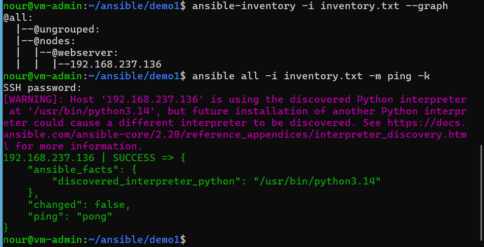
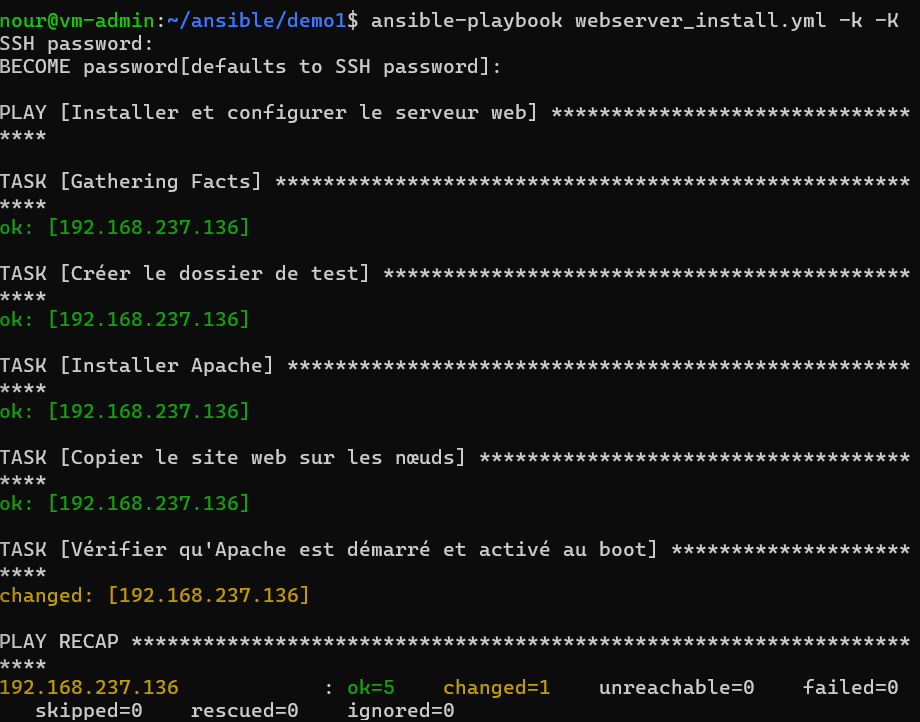
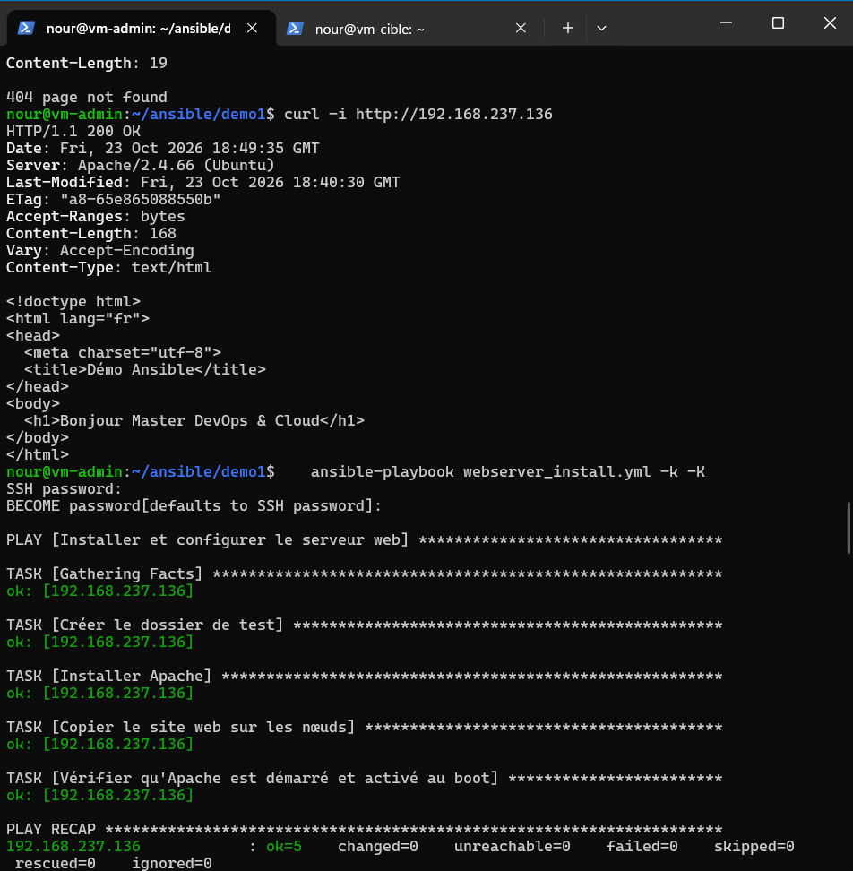
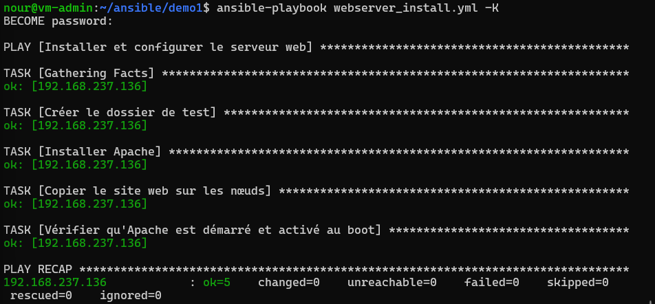
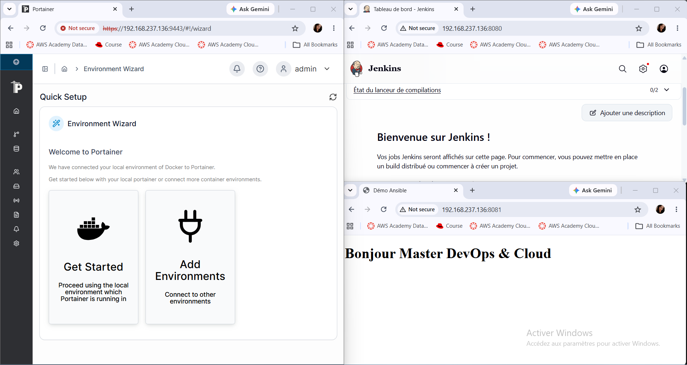
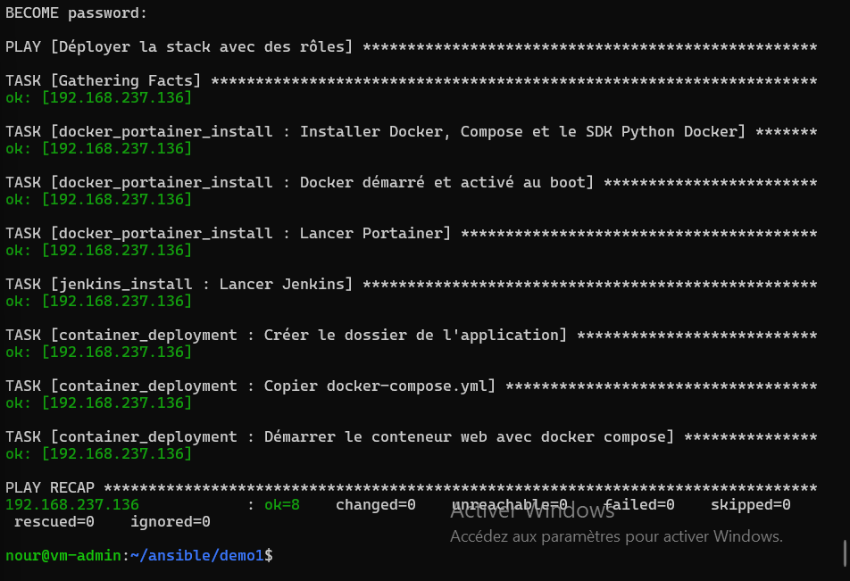

# TP4 : Bases d'Ansible

Master DevOps & Cloud, ISET Tozeur. Automatisation avec Ansible : inventaire, playbooks idempotents, authentification SSH par clé, déploiement de Docker, Portainer, Jenkins et d'un conteneur web, puis réorganisation en rôles.

## Architecture

| Machine | Rôle | IP |
|---|---|---|
| `vm-admin` | Nœud de contrôle Ansible | 192.168.237.135 |
| `vm-cible` | Nœud géré (groupe `webserver`) | 192.168.237.136 |

Utilisateur SSH : `nour` sur les deux machines.

## Contenu du dépôt

| Fichier | Rôle |
|---|---|
| `inventory.txt`, `ansible.cfg` | Inventaire et configuration du projet |
| `webserver_install.yml`, `index.html` | Partie 2 : installation d'Apache et copie du site |
| `Dockerfile`, `docker-compose.yml` | Partie 4 : image du site (nginx) et conteneur web |
| `docker_stack.yml` | Partie 4 : Docker, Portainer, Jenkins et conteneur web |
| `roles/`, `site.yml` | Partie 5 : même déploiement avec 3 rôles |
| `captures/` | Captures d'écran des livrables |

Rôles : `docker_portainer_install`, `jenkins_install`, `container_deployment`.

## Exécution

```bash
# Partie 0 et 1 : test de connexion
ansible all -m ping

# Partie 2 : premier playbook (puis relancer : changed=0)
ansible-playbook webserver_install.yml --syntax-check
ansible-playbook webserver_install.yml -K

# Partie 4 : Docker, Portainer, Jenkins, conteneur web
ansible-playbook docker_stack.yml -K

# Partie 5 : version avec rôles (relancer : changed=0)
ansible-playbook site.yml -K
```

## Accès aux services

| Service | URL |
|---|---|
| Site Apache (Partie 2) | http://192.168.237.136 |
| Conteneur web | http://192.168.237.136:8081 |
| Portainer | https://192.168.237.136:9443 |
| Jenkins | http://192.168.237.136:8080 |

Image Docker Hub : `nourki2003/ansible-demo-web:1.0`

## Différences par rapport à l'énoncé

- **2 VM au lieu de 3** (un nœud de contrôle et un nœud géré), à cause des limites matérielles du PC.
- **Jenkins en conteneur Docker** (image `jenkins/jenkins:lts-alpine-jdk21`) au lieu d'une installation par paquet, plus rapide et sans dépendance Java sur l'hôte.
- **Conteneur web sur le port 8081**, car Apache occupe déjà le port 80.
- Nginx et k3s ont dû être arrêtés sur `vm-cible` : ils occupaient le port 80 (Traefik de k3s interceptait le trafic avant Apache).
- **Image Alpine de Jenkins** choisie pour réduire le téléchargement sur une connexion lente.

## Captures

### 1. Test de connexion (`ansible all -m ping`)


### 2. Premier passage de `webserver_install.yml` et `curl`


### 3. Idempotence (deuxième passage, `changed=0`)


### 4. Authentification SSH par clé (exécution sans `-k`)


### 5. Jenkins, Portainer et conteneur web dans le navigateur


### 6. Playbook à base de rôles

